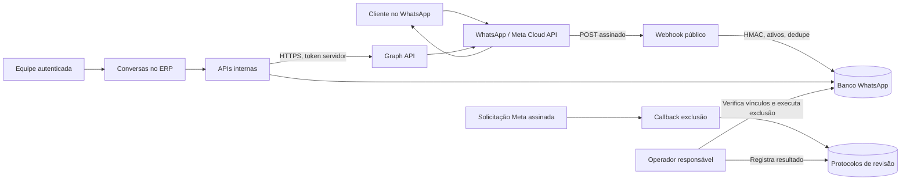

# WhatsApp Cloud API no sistema do Ateliê Milena Kerbage

Versão documental: 12 de outubro de 2026, horário de referência America/Sao_Paulo.

Este documento descreve por que a integração existe, o que foi implementado, como configurar e testar, quais URLs informar à Meta, como operar os dados e quais evidências preparar para eventual revisão. A aplicação integra **uma empresa, uma WABA e um número empresarial** pela Cloud API oficial. O objetivo é receber e responder atendimentos dentro do sistema, com histórico persistente, autorização comprovada, descadastramento e acompanhamento de entrega. A hospedagem escolhida é **Vercel**, com **PostgreSQL do Supabase** para produção e SQLite apenas para desenvolvimento/testes.

Código pronto e testes locais não equivalem a uma conta Meta ativada, URL publicada ou mensagem real entregue. O usuário informou que a conta/aplicativo Meta e o número ainda não foram criados. Também faltam acessos/configurações reais de Vercel e Supabase. Tokens, número, WABA, DNS, HTTPS, banco e canais de contato precisam ser fornecidos e validados. A aplicação informa configuração pendente e não apresenta uma integração fictícia como conectada. O gestor encontra a sequência de dependências e aceite em `docs/pendencias-implantacao-whatsapp.md` e a operação pelo painel em `docs/painel-gestor-whatsapp.md`.

## 1. Uso previsto e fronteiras do produto

### 1.1 Por que conectar o WhatsApp

- Centralizar a comunicação de clientes e contatos em `/conversas`, sem copiar manualmente mensagens entre dispositivos.
- Permitir respostas humanas pela equipe autorizada.
- Acompanhar envio, entrega, leitura e falha informados pela Meta.
- Aplicar a janela de atendimento de 24 horas e consultar modelos aprovados para envio fora dela.
- Registrar autorização e recusa, com origem/evidência e identificação do operador.
- Atender pedidos de exclusão do contato e evitar sua recriação indevida.
- Disponibilizar páginas públicas de transparência e o callback de exclusão quando requerido na configuração Meta.

### 1.2 Recursos efetivamente implementados

| Recurso | Implementação | Limite relevante |
| --- | --- | --- |
| Recepção | Webhook assinado, persistência PostgreSQL em produção/SQLite em testes, deduplicação e filtragem de ativos | Somente WABA e Phone Number ID configurados; eventos irrelevantes são ignorados |
| Conversas | Listagem de contatos ativos e mensagens com paginação | Não representa importação de todo histórico anterior do WhatsApp |
| Texto | Envio pela Graph API | 1–4096 caracteres, autorização registrada e janela de 24 horas aberta |
| Templates | Consulta de modelos da WABA e envio de modelo aprovado | Parâmetros posicionais de texto no corpo; não há editor/CRUD de templates |
| Entrega | Reconciliação de statuses recebidos, inclusive antes da resposta do envio | Estado técnico não comprova aceite, pagamento ou contratação |
| Leitura | Envio de marcação de leitura e atualização local | Depende da plataforma e da mensagem existente |
| Mídia recebida | Metadados e download autenticado | Até 3 MiB na Vercel e 16 MiB fora dela; tipos e origem permitidos; não salva binário em disco |
| Autorização | Registro pelo operador com evidência | Permissão global por contato; categorias não são campos separados |
| Descadastramento | Palavras exatas e revogação manual | Outros textos devem ser tratados por uma pessoa |
| Exclusão local | Remove contato/histórico e aplica supressão pseudonimizada | Não elimina automaticamente backups do provedor ou registros da Meta |
| Exclusão Meta | Valida `signed_request`, registra protocolo e mostra estado | Identificador Meta não é telefone; resultado exige revisão humana |
| Diagnóstico | Configuração local e consultas opcionais de número/assinatura WABA | `ready=true` indica configuração local, não certificação de produção |

### 1.3 Recursos fora desta entrega

Não foram implementados Embedded Signup universal, onboarding de empresas terceiras, multi-WABA, multi-tenant, campanhas em massa, WhatsApp Calling, Flows, pagamentos, catálogo, envio de arquivos, agendamento de campanha, IA de atendimento ou importação de conversas antigas. A autorização Meta clássica opcional do gestor não substitui o login interno próprio do ERP. Os módulos internos do ERP agora têm backend e papéis próprios; consulte [a documentação do ERP](erp-backend.md). Isso não acrescenta recursos à API do WhatsApp descrita nesta seção.

Para operar contas de outras empresas, será necessário um projeto próprio de provedor, isolamento de dados e credenciais, autorização/onboarding adequados e análise das permissões e da revisão exigidas pela Meta. Não reutilizar o token desta empresa como solução para clientes terceiros.

### 1.4 Como a equipe usa as telas

Em `/configuracoes/integracoes`, o gestor autorizado administra campos, credenciais, etapas, testes, catálogo de URLs, eventos e pedidos. Os segredos são informados em campos protegidos e guardados com criptografia pelo servidor; consultas retornam somente metadados. Banco, chave de criptografia e allowlist de gestores são bootstrap privado. A conexão OAuth, quando habilitada para o app real, continua sendo autorização da Meta e não emissão local de acesso.

`/configuracoes/whatsapp` abre o mesmo painel administrativo na aba de testes. A consulta remota é uma ação explícita. A listagem de modelos mostra nome, idioma, categoria e situação da conta. O teste de envio exige um destinatário autorizado e resultado real, sem simular conexão. Operadores sem função de gestor atendem em `/conversas`.

Em `/conversas`, escolha um contato recebido pelo webhook ou abra um número internacional autorizado. Consulte as mensagens, registre a origem/evidência de autorização, escolha texto ou modelo compatível e confira o status. A lista é atualizada periodicamente (10 segundos), e o histórico da conversa aberta a cada 5 segundos; não é transporte realtime via Supabase. A busca atua na página de contatos carregada, inicialmente até 100; não é pesquisa global de todo banco. O histórico antigo usa o cursor retornado pela API.

As consultas automáticas de polling não renovam a inatividade da sessão. O limite de 30 minutos continua aplicável mesmo com a tela aberta; navegação renderizada e mutações autorizadas representam atividade no mecanismo de sessão. Se a sessão encerrar, entre novamente antes de enviar ou acessar mídia. O limite absoluto permanece 8 horas.

A leitura é uma ação explícita, e o download de mídia exige o limite permitido. Recusa registra revogação; exclusão pede `EXCLUIR` e evidência de verificação da identidade. Fichas persistidas de leads não são automaticamente vinculadas ao identificador real do WhatsApp; as notas do CRM são internas e a caixa de atendimento usa os eventos reais da integração. Não tratar um nome coincidente como prova de vinculação.

## 2. Identidade empresarial e origem

Dados informados pelo responsável pelo projeto, sem consulta cadastral independente nesta tarefa:

| Item | Valor |
| --- | --- |
| Nome comercial | Ateliê Milena Kerbage |
| Responsável jurídico informado | Milena Cavalcante Kerbage |
| CNPJ informado | 13.592.162/0001-08 |
| Endereço informado | Rua Professor Heraclito, 233, Vicente Pinzon, Fortaleza - CE, CEP 60181-245 |
| Domínio confirmado pelo usuário | `ateliemilenakerbage.com.br` |
| Origem proposta para a aplicação | `https://app.ateliemilenakerbage.com.br` |
| Canal eletrônico de privacidade confirmado | `milenakerbageatelie@gmail.com` |
| Canal de suporte confirmado | `milenakerbageatelie@gmail.com`; telefone oficial ainda a confirmar |

A origem acima é a URL a publicar. O código e a autorização para usar o domínio não criam DNS, certificado ou hospedagem automaticamente. APIs e interface usam a mesma origem; não é necessário inventar um subdomínio `api`.

## 3. URLs da aplicação e do painel Meta

Use a origem pública real configurada, sem usuário/senha, query ou fragmento. A produção exige HTTPS.

| Finalidade | Caminho | URL proposta |
| --- | --- | --- |
| Sistema / App URL | `/` | `https://app.ateliemilenakerbage.com.br/` |
| Login da equipe | `/login` | `https://app.ateliemilenakerbage.com.br/login` |
| Caixa de atendimento | `/conversas` | `https://app.ateliemilenakerbage.com.br/conversas` |
| Painel de gestão da integração | `/configuracoes/integracoes` | `https://app.ateliemilenakerbage.com.br/configuracoes/integracoes` |
| Diagnóstico e teste de atendimento | `/configuracoes/whatsapp` | `https://app.ateliemilenakerbage.com.br/configuracoes/whatsapp` |
| Webhook WhatsApp | `/api/whatsapp/webhook` | `https://app.ateliemilenakerbage.com.br/api/whatsapp/webhook` |
| Privacy Policy URL | `/privacidade` | `https://app.ateliemilenakerbage.com.br/privacidade` |
| Terms of Service URL | `/termos` | `https://app.ateliemilenakerbage.com.br/termos` |
| Instruções de exclusão | `/exclusao-de-dados` | `https://app.ateliemilenakerbage.com.br/exclusao-de-dados` |
| Data Deletion Callback URL | `/api/meta/data-deletion` | `https://app.ateliemilenakerbage.com.br/api/meta/data-deletion` |
| Acompanhamento de exclusão | `/exclusao-de-dados/status?code=…` | Página pública gerada pelo callback, com protocolo aleatório |
| Acompanhamento via API | `/api/meta/data-deletion/status?code=…` | Resposta JSON pública limitada ao protocolo |
| Central de políticas | `/politicas` | `https://app.ateliemilenakerbage.com.br/politicas` |
| Cookies | `/cookies` | `https://app.ateliemilenakerbage.com.br/cookies` |
| Regras de comunicação | `/politica-de-comunicacao` | `https://app.ateliemilenakerbage.com.br/politica-de-comunicacao` |
| Callback OAuth condicional | `/api/whatsapp/management/oauth/callback` | `https://app.ateliemilenakerbage.com.br/api/whatsapp/management/oauth/callback` |

As páginas legais, os dois métodos do webhook e o callback/consulta de exclusão devem funcionar sem sessão. As demais APIs verificam a sessão dentro dos handlers. A exceção pública precisa ser exata: não liberar indiscriminadamente todo `/api/whatsapp` ou `/api/meta` no proxy.

A política de privacidade e as instruções/callback de exclusão são itens a validar no painel e nos termos aplicáveis ao aplicativo. Cookies, termos de uso e política de comunicação são documentos complementares úteis ao funcionamento e à transparência; não se deve afirmar que cada um deles é uma exigência universal de todo aplicativo Meta. O formulário vigente, os produtos habilitados e as permissões pedidas determinam os campos necessários.

## 4. Arquitetura e fluxo dos dados



### 4.1 Recebimento

1. Meta entrega o corpo bruto e `X-Hub-Signature-256` ao webhook.
2. O handler limita o tamanho do corpo, valida HMAC-SHA256 com o App Secret e somente depois interpreta o JSON.
3. O processador exige `object=whatsapp_business_account`, WABA correspondente, campo `messages` e `metadata.phone_number_id` correspondente.
4. Mensagens e statuses são deduplicados. Conteúdos antigos além da retenção, timestamps excessivamente futuros e contatos suprimidos são descartados.
5. O banco guarda contato, mensagem e informações operacionais pertinentes. A persistência é concluída antes da resposta `EVENT_RECEIVED`.
6. A interface consulta as APIs internas para atualizar a caixa de atendimento.

O webhook não baixa anexos automaticamente nem armazena payload bruto integral. Para eventos que não fazem parte do escopo, retornar 200 após ignorá-los evita tratar tudo como erro; assinatura inválida ou corpo inválido recebe erro. Não responder 200 antes de garantir persistência do que será aceito.

### 4.2 Envio

1. O operador escolhe um contato e registra autorização real com evidência.
2. O servidor valida sessão, origem, corpo e limite; confere supressão/autorização.
3. Texto livre exige última mensagem recebida dentro de 24 horas. Template exige consulta à WABA, status `APPROVED`, idioma e parâmetros compatíveis.
4. O cliente fornece `clientRequestId` único. O servidor reserva essa chave no banco antes do POST à Meta.
5. A Graph API recebe o envio com o token exclusivamente no cabeçalho do servidor.
6. A resposta e os eventos de status reconciliam o identificador e o estado da mensagem.

Em timeout ou resposta inconclusiva, o resultado local pode ser `unknown`. Reenviar cegamente com nova chave pode duplicar a mensagem. Aguarde o webhook, consulte o histórico e faça revisão antes de decidir um novo envio. O sistema não usa repetição automática ilimitada de POSTs.

### 4.3 Separação de identidades

`phone` é o número internacional do contato do WhatsApp. `WHATSAPP_PHONE_NUMBER_ID` é o identificador Graph do número comercial da empresa. `WHATSAPP_BUSINESS_ACCOUNT_ID` é a WABA. `user_id` do callback Meta é um identificador da conta no contexto do aplicativo. São conceitos diferentes e não devem ser convertidos uns nos outros por suposição.

## 5. Ambiente e segredos

Leia também `docs/autenticacao.md`. O projeto usa runtime Node e acesso HTTPS de saída à Meta. Desenvolvimento/testes com SQLite requerem Node.js 22.13 ou posterior com `node:sqlite`. Em produção na Vercel, autenticação, conversas, limitadores, configuração administrativa e protocolos de exclusão usam o PostgreSQL compartilhado do Supabase por `DATABASE_URL`; arquivos locais não oferecem persistência adequada para esse ambiente.

A configuração inicial privada exige conexão do banco, chave de criptografia e lista de gestores. Depois disso, o painel `/configuracoes/integracoes` permite editar as informações administrativas e guardar credenciais no banco com AES-GCM no servidor. O access token e App Secret só podem ser obtidos por emissão/autorização da Meta. Verify Token e a primeira chave de supressão podem ser gerados localmente para suas finalidades próprias. Campos de segredo vazios preservam o valor já armazenado; o GET não permite recuperar valores antigos.

As variáveis WhatsApp/legais abaixo também identificam o contrato do servidor e o fallback de instalações existentes. Para a operação cotidiana do gestor, utilize o painel; não exigir alteração de arquivo de ambiente a cada ajuste de número, token, contato ou retenção. A configuração do banco e a chave que protege os segredos continuam fora da UI.

| Variável | Uso e validação |
| --- | --- |
| `DATABASE_URL` | Segredo PostgreSQL do projeto Supabase, acessível apenas pelo servidor; usar conexão apropriada ao ambiente Vercel e TLS |
| `INTEGRATION_ENCRYPTION_KEY` | Chave privada para criptografar/descriptografar credenciais guardadas no banco; rotação requer procedimento técnico |
| `INTEGRATION_MANAGER_EMAILS` | E-mails de contas internas autorizadas a administrar a integração; controle próximo aos dados e não apenas botão escondido |
| `META_OAUTH_ENABLED` | `true` habilita a opção clássica de autorização apenas após configurar app, callback e permissões na Meta; não é necessário para token manual |
| `META_APP_ID` | App ID no fallback de ambiente; o gestor também pode informá-lo no painel |
| `DATABASE_SSL_CA` | CA PEM opcional fornecida pelo projeto para validação do certificado; sem ela usa a cadeia confiável do runtime |
| `DATABASE_SSL_MODE` | Somente `disable` para teste automatizado em PostgreSQL local, `NODE_ENV=test` e fora da Vercel; não utilizar em produção |
| `AUTH_ORIGIN` | Origem exata aceita para mutações; HTTPS em produção |
| `AUTH_REQUIRE_LOGIN` | `true` exige login também em desenvolvimento; produção exige sempre |
| `PUBLIC_BASE_URL` | Origem pública principal, compartilhada entre URLs e callback |
| `WHATSAPP_PUBLIC_BASE_URL` | Alternativa se `PUBLIC_BASE_URL` não existir; fallback seguinte é `AUTH_ORIGIN` |
| `WHATSAPP_GRAPH_VERSION` | Versão explicitamente suportada no painel, formato `vNN.0`; não há `latest` automático |
| `WHATSAPP_ACCESS_TOKEN` | Token autorizado para os ativos e permissões realmente necessários |
| `META_APP_SECRET` | App Secret compartilhado primário para HMAC de webhook e callback de exclusão; mínimo local de 16 caracteres |
| `WHATSAPP_APP_SECRET` | Alternativa ao `META_APP_SECRET` se este não existir; deve corresponder ao aplicativo |
| `WHATSAPP_VERIFY_TOKEN` | Segredo escolhido para o handshake; mínimo 16 caracteres; não é o access token |
| `WHATSAPP_PHONE_NUMBER_ID` | ID Graph do número comercial, 5–30 dígitos na validação local |
| `WHATSAPP_BUSINESS_ACCOUNT_ID` | WABA, 5–30 dígitos na validação local |
| `WHATSAPP_SUPPRESSION_SECRET` | Chave estável aleatória com pelo menos 32 caracteres, distinta dos demais segredos |
| `WHATSAPP_DB_PATH` | Padrão `.data/whatsapp.sqlite` no adaptador local de desenvolvimento/teste; não usar como banco Vercel |
| `WHATSAPP_RETENTION_DAYS` | Padrão 90; inteiro entre 1 e 3650; valor inválido retorna ao padrão |
| `AUTH_DB_PATH` | Banco local de autenticação no desenvolvimento/teste, padrão `.data/auth.sqlite` |
| `META_DELETION_DB_PATH` | Protocolos locais de teste, padrão `.data/meta-deletion.sqlite` |
| `LEGAL_ENTITY_NAME`, `LEGAL_CNPJ`, `LEGAL_ADDRESS` | Sobrescrevem a identificação empresarial informada |
| `LEGAL_PRIVACY_EMAIL`, `LEGAL_SUPPORT_EMAIL` | Canais válidos que precisam ser acompanhados pela empresa |
| `LEGAL_WHATSAPP_PHONE` | Número público do atendimento com DDI; diferente do Phone Number ID |

As variáveis são do servidor. **Não usar `NEXT_PUBLIC_` para token, App Secret, segredo de supressão ou banco.** Não incluir credenciais em URLs, print de revisão, histórico de terminal, JSON do diagnóstico, repositório ou tickets. `.env.example` contém campos vazios e não é credencial real.

Se App Secrets separados forem definidos, conferir que correspondem ao mesmo aplicativo e ao callback utilizado. Se a origem pública e a origem de autenticação divergirem sem uma razão de infraestrutura documentada, os envios podem ser bloqueados pela validação de Origin.

O segredo da supressão não deve ser trocado arbitrariamente: a troca perde a capacidade de reconhecer hashes antigos e pode permitir recontato. Planeje migração, preserve a chave em cofre e teste o bloqueio após restauração. O App Secret também participa do hash da identidade nos protocolos Meta, então sua rotação precisa considerar a continuidade da revisão dos pedidos pendentes.

### 5.1 Supabase e Vercel

Crie projetos de homologação e produção separados, ou outra separação com acesso e dados efetivamente isolados. Selecione a região do banco no painel e registre a decisão; São Paulo (`sa-east-1`) aparece entre as [regiões disponíveis](https://supabase.com/docs/guides/platform/regions), mas nenhuma região real foi selecionada nesta tarefa. Região do banco não prova residência integral de logs, subprocessadores ou serviços da Meta.

A conexão do servidor usa o driver PostgreSQL, não uma chave `anon` no navegador. O aplicativo mantém sua autenticação própria no esquema `erp_auth`; não presume usuários criados pelo Supabase Auth. Os outros esquemas são `erp_whatsapp`, `erp_meta` e `erp_core`. Eles devem permanecer fora dos esquemas expostos da Data API e sem acesso pelos papéis públicos `anon`/`authenticated`, salvo uma mudança deliberada de arquitetura com controles próprios. Credencial privilegiada do banco nunca deve chegar ao frontend. Consulte [segurança do Supabase](https://supabase.com/docs/guides/database/secure-data).

O adaptador `src/lib/database.ts` é assíncrono, compartilha pool `pg` com limite de uma conexão por instância e executa `SET LOCAL search_path` dentro de cada transação. Não há prepared statement nomeado. TLS usa verificação de certificado, com CA opcional; parâmetros de SSL da URL não podem enfraquecer essa verificação. Na Vercel, ausência de `DATABASE_URL` é erro de configuração e não aciona SQLite como armazenamento alternativo silencioso.

Para funções serverless, a [documentação de conexão Supabase](https://supabase.com/docs/guides/database/connecting-to-postgres) orienta usar pooler em modo de transação e pool de aplicação reduzido. Copie host, porta e usuário do painel Connect; não construa hostname a partir de região ou project-ref. A conexão deve exigir TLS e validar o servidor conforme o certificado apropriado. Não resolver falha de certificado com `rejectUnauthorized=false`. Não usar prepared statements nomeados ou depender de estado de sessão entre transações no transaction pooler.

Antes do primeiro acesso, aplique os arquivos de migração na ordem:

1. `supabase/migrations/001_auth.sql`
2. `supabase/migrations/002_whatsapp.sql`
3. `supabase/migrations/003_meta_deletion.sql`
4. `supabase/migrations/004_integration_settings.sql`
5. `supabase/migrations/005_integration_manager.sql`

Faça isso pelo fluxo administrativo autorizado do Supabase ou ferramenta de migração apropriada, registre o resultado e confira esquemas/permissões. Não colar dados pessoais ou segredos no conteúdo das migrações. Configure `DATABASE_URL` em variáveis sensíveis do projeto Vercel e separe Production/Preview/Development para não conectar preview ao banco real sem intenção explícita. Faça redeploy após mudança de ambiente e teste o banco, o login e a persistência entre invocações.

Backups, retenção do fornecedor, planos, limites, custos, disponibilidade e contratos são decisões da instalação. A entrega não criou contas remotas, não aplicou migrações a um banco real e não publicou DNS. Não importar banco de clientes enquanto os testes e o acesso estiverem pendentes.

### 5.2 Painel de gestor e criptografia das credenciais

`src/lib/whatsapp/config.ts` combina configuração persistida com fallback de ambiente. Valores salvos no banco prevalecem; segredos existentes não são retornados por `GET management/config`. A resposta apresenta somente presença, origem (`database`, `environment` ou `none`) e data pertinente. Dados públicos de identidade, origem e retenção podem ser consultados separadamente sem decifrar segredos, para as políticas públicas.

Access token, App Secret, Verify Token e segredo de supressão são cifrados com AES-256-GCM: chave de 32 bytes em base64 da hospedagem, IV aleatório de 12 bytes, tag de autenticação e AAD vinculada ao nome do segredo/versão. O banco contém o envelope cifrado; a chave não fica no mesmo registro. Isso protege esses campos de configuração e não declara que todas as tabelas de mensagens ou todo volume do fornecedor tenham sido criptografados pelo aplicativo.

Mutações administrativas exigem sessão válida, e-mail na allowlist, Origin e limites de uso. O acesso demonstrativo local só existe nas condições de desenvolvimento/loopback; não deve liberar gestão anônima em produção. A supressão já configurada não pode ser alterada ou removida pelo fluxo comum: há bloqueio no servidor e serialização de alterações, pois a troca perderia reconhecimento dos hashes existentes.

`INTEGRATION_ENCRYPTION_KEY` exige representação base64 canônica de 32 bytes. A chave de bootstrap, `DATABASE_URL`, `INTEGRATION_MANAGER_EMAILS` e `AUTH_ORIGIN` são configurados pelo administrador no ambiente privado. `AUTH_ORIGIN` já é uma dependência da autenticação existente. OAuth é opcional e acrescenta a habilitação técnica `META_OAUTH_ENABLED=true` após a configuração Meta.

No desenvolvimento em loopback e fora da Vercel, `POST management/bootstrap` com `GENERATE_LOCAL_ENCRYPTION_KEY` prepara a primeira chave em `.env.local` privado (0600), devolvendo o valor novo somente naquela resposta. Não é provisionamento de produção, não recupera uma chave antiga e não deve ser exposto fora das condições locais. Preserve a chave em cofre e proteja cópias desse arquivo; sem a original, os envelopes cifrados não podem ser recuperados pela aplicação.

O `PUT config` pode desativar access token/App Secret/Verify Token pelo campo `removeSecrets`; um registro cifrado vazio impede o fallback automático ao valor de ambiente. A chave de supressão permanece protegida contra remoção/rotação. A desativação local não revoga o token no provedor Meta e pode interromper o canal; a revogação externa é uma ação administrativa separada.

### 5.3 Autorização Meta opcional e inspeção de token

O fluxo implementado é clássico e condicionado a um app habilitado para Facebook Login, callback cadastrado e permissões disponíveis. Não foi implementado `config_id`/Embedded Signup universal nem emissão local de token Meta. Os documentos Developers atuais tiveram bloqueio 429; o contrato clássico foi cruzado com o SDK oficial histórico. A adequação à conta atual e a emissão real permanecem a testar externamente.

O início usa POST administrativo confirmado (`AUTORIZAR_META`) e sessão real. Gera estado aleatório de 32 bytes, guarda apenas SHA-256 do estado e da sessão, vincula ao usuário e expira em 10 minutos. A URL oficial é `https://www.facebook.com/{versao}/dialog/oauth`, com `client_id`, `state`, `response_type=code`, `redirect_uri` exata e scopes `whatsapp_business_management,whatsapp_business_messaging`.

No callback, estado válido é consumido uma vez; cancelamento/recusa não produz credencial fictícia. A troca ocorre somente no servidor em `/{versao}/oauth/access_token`, com `client_id`, `client_secret`, `code` e a mesma `redirect_uri`. A resposta é limitada, redirects remotos são recusados e erros não imprimem token ou URL de callback. O token emitido é salvo cifrado, e o usuário recebe HTTP 303 para o painel com resultado limitado (`connected`, `denied` ou `failed`), sem código ou token na URL de destino.

A inspeção usa o request oficial `/{versao}/debug_token`, com autenticação do app no servidor. Retorna `valid`, `appMatches`, tipo, scopes, permissões ausentes e datas fornecidas pela Meta. Uma data ausente não comprova validade permanente. O diagnóstico da WABA e a entrega real continuam necessários.

A ação `extend` exige `RENOVAR`, inspeção de token `USER` válido e app correspondente. Solicita `grant_type=fb_exchange_token` e `fb_exchange_token` à Meta, guarda o novo valor e devolve somente metadados da duração. Não transforma `USER` em `SYSTEM_USER`/BISU, não promete 60 dias em todo caso nem validade permanente e não implementa refresh automático ilimitado. A via de token empresarial emitido no Meta Business continua disponível para ativos próprios.

## 6. Configuração no Meta Developers e WhatsApp Manager

Os menus e critérios variam com o aplicativo e a conta. A sequência abaixo descreve as dependências a conferir, não afirma que uma conta específica foi ativada.

1. Acesse Meta Developers com a conta autorizada e selecione/crie o aplicativo empresarial compatível com a WhatsApp Business Platform.
2. Confirme portfólio empresarial, WABA e número pertencentes ao Ateliê. Use primeiro os ativos de teste disponibilizados pelo painel e um destinatário que consentiu no teste.
3. Obtenha Phone Number ID e WABA ID no painel. Não use o telefone exibido como substituto de um ID Graph.
4. Gere um token com acesso aos ativos corretos. Para operação contínua, avalie o usuário de sistema e validade/permissões mostradas pela Meta; não mantenha o token temporário de teste como solução de produção.
5. Configure os segredos e IDs no servidor sem expô-los ao navegador. Selecione a versão da Graph API a partir da documentação/painel vigente e registre a decisão.
6. Publique a origem HTTPS, confira DNS/certificado e teste acesso público às políticas. Configure App Domains e demais campos que o painel pedir com o domínio confirmado.
7. Configure a Callback URL WhatsApp e o Verify Token. O GET precisa devolver `hub.challenge` em texto, sem HTML, redirect ao login ou objeto JSON.
8. Inscreva o aplicativo no objeto WABA e no campo `messages`, conforme o fluxo vigente. Configure/valide a inscrição na conta WABA; salvar o endereço do callback sozinho não garante inscrição de todos os ativos.
9. Configure política de privacidade e exclusão nos campos correspondentes. Use a URL da página para instruções; use o endpoint POST apenas no campo destinado a callback.
10. Complete o perfil comercial, contato de suporte, identidade e informações exigidas. Confira verificação, registro do número, situação do nome de exibição, cobrança e limites que o painel mostrar.
11. Execute diagnóstico, teste real controlado e o roteiro de evidências abaixo. Remova os dados de teste quando não forem mais necessários.

### 6.1 Permissões e revisão

O envio e recebimento de mensagens utiliza `whatsapp_business_messaging`; leitura/gestão de ativos e modelos depende de `whatsapp_business_management` e do acesso aos ativos pertinente à operação. Solicitar `business_management` apenas se houver função concreta que o necessite. Não pedir permissões de Instagram, Pages, Ads ou de outros produtos sem uso implementado.

Há diferença entre um desenvolvedor direto usando ativos próprios e um provedor que acessa ativos de outras empresas. Confirmar no painel e na documentação atual qual nível de acesso/revisão é exigido para o caso do Ateliê. Esta implementação não promete que App Review é dispensado nem que Advanced Access é necessário em toda situação. As páginas de revisão consultadas tiveram bloqueio de acesso nesta pesquisa; esse ponto continua exigindo validação da conta antes de submissão.

### 6.2 Número existente e coexistência

Antes de registrar um número já usado no WhatsApp Business App, leia o fluxo vigente de migração/coexistência que a Meta oferecer à conta. Não desative um número operacional presumindo que todo histórico será migrado ou que todos os cenários têm coexistência. A implementação atual recebe os eventos Cloud API do escopo configurado; não implementa espelhamento de `smb_message_echoes` ou sincronização completa da aplicação móvel.

### 6.3 Custos e limites

Não presumir gratuidade por estar dentro da janela de 24 horas. A janela regula o tipo de mensagem permitido; a cobrança tem regras próprias e pode mudar. Consulte [pricing oficial](https://developers.facebook.com/documentation/business-messaging/whatsapp/pricing/) e [mensagens sem template](https://developers.facebook.com/documentation/business-messaging/whatsapp/pricing/non-template-messages) na data da ativação, além da cobrança exibida na conta. Os documentos ficaram bloqueados nesta consulta; nenhum valor, franquia ou condição de gratuidade atual foi confirmado aqui.

O app não calcula fatura, saldo, preço por país, tier de volume ou validade comercial de modelos. Limites locais de segurança não são os limites comerciais/técnicos da Meta. Monitorar qualidade do número, recusas, bloqueios, modelos pausados e limites da WABA. Não contornar uma restrição usando outro número ou criando chaves novas repetidamente.

## 7. Referência das APIs internas

Respostas JSON autenticadas usam `Cache-Control: no-store, private`. Erros conhecidos retornam `error` e, nas falhas WhatsApp, `code`. O código HTTP é parte do contrato. Não tratar uma mensagem de erro como conversa enviada.

| Método e caminho | Entrada | Resposta principal | Acesso |
| --- | --- | --- | --- |
| `GET /api/whatsapp/management/overview` | Sem corpo | Dependências, etapas, progresso, catálogo e disponibilidade OAuth | Gestor |
| `GET /api/whatsapp/management/guide` | Padrão manual; `document=technical` ou `document=pending` | Documento Markdown como anexo | Gestor; whitelist de documentos, nunca filepath livre |
| `GET /api/whatsapp/management/config` | Sem corpo | Campos e metadados da presença/origem de segredos | Gestor |
| `POST /api/whatsapp/management/bootstrap` | `action=GENERATE_LOCAL_ENCRYPTION_KEY` | Primeira chave local, exibida uma vez | Desenvolvimento loopback; nunca Vercel/produção |
| `PUT /api/whatsapp/management/config` | `values` e credenciais novas em `secrets`, quando informadas | Configuração atualizada sem revelar credenciais | Gestor + Origin |
| `POST /api/whatsapp/management/secrets` | `kind=verifyToken|suppressionSecret` | Segredo local novo exibido uma vez e confirmação de armazenamento | Gestor + Origin |
| `PUT /api/whatsapp/management/checklist` | Item, situação e observação mínima | Etapa atualizada | Gestor + Origin |
| `POST /api/whatsapp/management/tests` | Teste nomeado | Resultado, resumo e data da verificação | Gestor + Origin |
| `GET /api/whatsapp/management/events` | Sem corpo | Eventos administrativos limitados | Gestor |
| `GET /api/whatsapp/management/deletions` | Sem corpo | Protocolos e situações de revisão | Gestor |
| `POST /api/whatsapp/management/deletions` | Revisão confirmada com evidência adequada | Resultado do procedimento | Gestor + Origin |
| `POST /api/whatsapp/management/subscribe` | `confirmation=INSCREVER` | Resultado da inscrição WABA na Meta | Gestor + Origin |
| `POST /api/whatsapp/management/token` | `action=inspect` | Metadados retornados pela Meta, sem token | Gestor + Origin |
| `POST /api/whatsapp/management/token` | `action=extend`, `confirmation=RENOVAR` | Confirmação da troca de duração de token USER, sem segredo | Gestor + Origin |
| `POST /api/whatsapp/management/oauth/start` | `confirmation=AUTORIZAR_META` | URL oficial de autorização com estado de uso único | Gestor + Origin |
| `GET /api/whatsapp/management/oauth/callback` | `code`, `state` ou cancelamento retornado pela Meta | Retorno limpo ao painel, sem token no navegador | Sessão do gestor + estado |
| `GET /api/whatsapp/status` | Opcional `diagnostic=1` | `ready`, `checks`, IDs, URLs, retenção, armazenamento, limite de mídia, conversas não lidas e último webhook; diagnóstico remoto opcional | Sessão |
| `GET /api/whatsapp/conversations` | `limit` 1–100, `offset` 0–100000 | `{ conversations: [...] }` | Sessão |
| `GET /api/whatsapp/messages` | `phone`, opcional `before`, `limit` 1–100 | `{ messages, conversation, nextBefore }` | Sessão |
| `POST /api/whatsapp/messages` | JSON de texto/template e `clientRequestId` | `{ message, duplicate }` | Sessão + Origin |
| `POST /api/whatsapp/consent` | `phone`, `status=granted|revoked`, `source` 5–500 caracteres | `{ conversation }` | Sessão + Origin |
| `DELETE /api/whatsapp/contacts` | `phone`, `confirmation=EXCLUIR`, `identityVerification` 10–500 caracteres | `{ deleted, suppressed }` | Sessão + Origin |
| `GET /api/whatsapp/templates` | Sem corpo | `{ templates, truncated }` | Sessão |
| `POST /api/whatsapp/read` | `messageId` | `{ success, duplicate? }` | Sessão + Origin |
| `GET /api/whatsapp/media` | `messageId` | Download com disposição `attachment` | Sessão |
| `GET /api/whatsapp/webhook` | `hub.mode`, `hub.verify_token`, `hub.challenge` | Challenge em texto | Público + token de verificação |
| `POST /api/whatsapp/webhook` | Corpo bruto JSON + `X-Hub-Signature-256` | `EVENT_RECEIVED` | Público + HMAC |
| `POST /api/meta/data-deletion` | Formulário URL encoded com `signed_request` | `{ url, confirmation_code }` | Público + HMAC |
| `GET /api/meta/data-deletion/status` | `code` aleatório 48 hex | Situação pública limitada | Público + protocolo |

Telefone internacional: somente 8–15 dígitos, com DDI e primeiro dígito não zero; um `+` inicial é aceito e removido. Não aceitar número local ambíguo. `before` é um cursor opaco retornado em `nextBefore` ou data ISO aceita pelo servidor; prefira reaproveitar o cursor para evitar perder mensagens com mesmo timestamp. A listagem não inclui contatos descadastrados.

### 7.1 Autorização

```json
{
  "phone": "<numero-internacional-do-contato-de-teste>",
  "status": "granted",
  "source": "Autorização de atualização do pedido recebida em formulário: referência interna verificável"
}
```

`source` precisa apontar uma evidência real, não uma frase genérica fabricada. O banco guarda operador e timestamp. O esquema atual possui uma autorização global por contato: a empresa deve controlar a categoria na evidência e no procedimento; se quiser consentimentos independentes por categoria, é necessário ampliar o modelo e os controles antes de campanha.

### 7.2 Texto

```json
{
  "phone": "<numero-internacional-do-contato-de-teste>",
  "type": "text",
  "text": "Mensagem de teste autorizada do Ateliê Milena Kerbage.",
  "clientRequestId": "<uuid-aleatorio-do-envio>"
}
```

`clientRequestId`: 8–100 caracteres alfanuméricos, `_` ou `-`. A mesma chave com mesmo conteúdo e envio confirmado retorna duplicata sem outro POST. A mesma chave com conteúdo diferente retorna conflito. Envio iniciado ou inconclusivo exige revisão. Não criar chave diferente apenas para vencer essa proteção.

### 7.3 Template de corpo com parâmetros posicionais

```json
{
  "phone": "<numero-internacional-do-contato-de-teste>",
  "type": "template",
  "template": {
    "name": "<nome-aprovado-na-waba>",
    "language": "pt_BR",
    "components": [
      {
        "type": "body",
        "parameters": [{ "type": "text", "text": "<valor-da-variavel-1>" }]
      }
    ]
  },
  "clientRequestId": "<uuid-aleatorio-do-envio>"
}
```

O nome e idioma devem existir na WABA, com status aprovado. O servidor confere a quantidade de variáveis do corpo. São aceitos até 30 parâmetros de texto, cada um com até 1024 caracteres. Templates com parâmetros nomeados, cabeçalho que requer mídia/variáveis ou URLs variáveis em botões não estão suportados. A consulta pagina até 20 páginas de 100 registros; `truncated=true` exige considerar que a lista ficou incompleta. Não assumir que uma lista incompleta prova inexistência de todo modelo.

### 7.4 Exclusão autenticada do contato

```json
{
  "phone": "<numero-verificado-do-solicitante>",
  "confirmation": "EXCLUIR",
  "identityVerification": "Pedido verificado por retorno no mesmo canal; referência interna sem documento sensível"
}
```

A verificação deve ser real e proporcional. O registro de auditoria guarda hash da evidência, operador e data; o texto completo não é salvo por esse endpoint. Guarde apenas a referência legítima no processo interno apropriado. A transação remove o contato e registros vinculados, limpa statuses associados e aplica supressão. Ela não identifica automaticamente dados em outros módulos do ERP ou em fornecedores externos.

### 7.5 Erros esperados

| Código | Significado | Providência |
| --- | --- | --- |
| `UNAUTHORIZED` / HTTP 401 | Sessão ausente ou encerrada | Entrar novamente |
| `MANAGER_REQUIRED` / 403 | Conta fora da lista de gestores | Administrador confere a allowlist; não compartilhar conta |
| `TOKEN_NOT_AUTHORIZED` / 409 | Token/app/scopes incompatíveis com inscrição WABA | Corrigir inspeção; o servidor não inicia o POST de inscrição nessa situação |
| `ENCRYPTION_NOT_CONFIGURED` / 503 | Chave de criptografia ausente/inválida | Administrador configura a chave original, 32 bytes em base64 |
| `ENCRYPTION_DECRYPT_FAILED` / 503 | Credenciais não puderam ser decifradas | Conferir a chave original e integridade; não substituir arbitrariamente |
| `SUPPRESSION_ROTATION_BLOCKED` / 409 | Tentativa de trocar chave estável de supressão | Rotação requer migração técnica administrada |
| `OAUTH_NOT_CONFIGURED` / 503 | Fluxo opcional não habilitado/configurado | Conferir app, callback, origem e flag; token manual segue disponível |
| `TOKEN_NOT_EXTENDABLE` / 409 | Tipo/estado de token incompatível com extensão | A ação se aplica a USER válido do próprio app; não gera token de sistema |
| `NOT_CONFIGURED` / 503 | Variáveis ou origem pendentes | Completar configuração no servidor e reiniciar |
| `CONSENT_REQUIRED` / 409 | Sem autorização registrada | Obter e registrar evidência real |
| `OPTED_OUT` / 409 | Recusa/supressão ativa | Respeitar a escolha; nova autorização comprovada se a pessoa quiser retomar |
| `WINDOW_CLOSED` / 409 | Janela encerrada para texto | Usar template aprovado e autorizado |
| `TEMPLATE_NOT_APPROVED` / 409 | Modelo/idioma não aprovado ou não localizado | Conferir WhatsApp Manager |
| `UNSUPPORTED_TEMPLATE` / 400 | Estrutura ainda não suportada | Escolher modelo compatível |
| `TEMPLATE_PARAMETERS_MISMATCH` / 400 | Variáveis incompatíveis | Ajustar parâmetros ao modelo |
| `REQUEST_ID_CONFLICT` / 409 | Chave usada com outro conteúdo | Investigar operação; não sobrescrever |
| `SEND_ALREADY_STARTED` / 409 | Envio já reservado/inconclusivo | Verificar histórico e webhook antes de novo envio |
| `META_UNAVAILABLE` / 502 | Resposta remota não confirmada | Tratar como resultado incerto |
| `META_REJECTED` / 429 ou 502 | Meta recusou e informou código | Consultar código e ativos no painel oficial |
| `INVALID_SIGNATURE` / 403 | Corpo/secret/assinatura incompatível | Revisar segredo e proxy; rejeitar evento |
| `RATE_LIMITED` / 429 | Limite local atingido | Aguardar, monitorar e dimensionar com segurança |
| `MEDIA_TOO_LARGE` / 413 | Arquivo acima do limite da instalação (3 MiB na Vercel; 16 MiB fora dela) | Não baixar por este endpoint |
| `UNSUPPORTED_MEDIA` / 415 | Tipo fora da allowlist | Utilizar procedimento autorizado apropriado |
| `VERIFICATION_REQUIRED` / 400 | Exclusão sem confirmação/evidência suficiente | Verificar o pedido antes de excluir |

## 8. Persistência, retenção e supressão

### 8.1 Bancos, esquemas e tabelas

Em produção, os dados ficam no PostgreSQL Supabase configurado por `DATABASE_URL`:

| Esquema | Conteúdo | Migração |
| --- | --- | --- |
| `erp_auth` | Usuários do ERP, hashes de senha, sessões, recuperação e limitador | `001_auth.sql` |
| `erp_whatsapp` | Contatos, mensagens, consentimento, deduplicação, envios, supressão e auditorias | `002_whatsapp.sql` |
| `erp_whatsapp` | Configuração administrativa e segredos cifrados (`integration_settings`), auditoria (`integration_audit`) | `004_integration_settings.sql` |
| `erp_whatsapp` | Etapas (`management_checklist`), testes (`management_tests`) e estados OAuth (`management_oauth_states`) | `005_integration_manager.sql` |
| `erp_meta` | Protocolos de exclusão e revisão | `003_meta_deletion.sql` |
| `erp_core` | CRM, funis, preferências e registros operacionais | `006_erp.sql` |
| `erp_auth` | Papéis, convites, chaves, fotos, webhooks, fila e notificações do ERP | `007_workspace_access.sql` |

Apenas o servidor deve consultar esses esquemas. O ERP usa autorização própria por papéis nas migrações `006_erp.sql` e `007_workspace_access.sql`, descrita no [manual do backend](erp-backend.md); não usa Supabase Auth nem isolamento multiempresa. Grants e exposição de API precisam ser conferidos no projeto real, além das verificações de sessão/origem feitas pelo ERP.

No desenvolvimento/teste, o adaptador SQLite utiliza:

| Banco | Conteúdo |
| --- | --- |
| `.data/auth.sqlite` | Usuários, hashes de senha, sessões, recuperação e limitador de autenticação |
| `.data/whatsapp.sqlite` | `contacts`, `messages`, `consent_audit`, `webhook_events`, `send_requests`, `pending_statuses`, `suppression`, `deletion_audit`, `metadata`, `rate_limits` |
| `.data/meta-deletion.sqlite` | Protocolos, hash da identidade Meta, situação, datas e nota de revisão |

O banco WhatsApp local usa arquivo 0600, diretório criado com modo 0700, foreign keys, transações, `journal_mode=DELETE`, `busy_timeout` e `secure_delete=ON`. Essas configurações não são garantias sobre o armazenamento do Supabase. Tanto a limpeza lógica quanto as permissões locais não provam remoção de snapshots nem criptografia de volume. O operador deve verificar as proteções efetivamente contratadas/configuradas.

### 8.2 Retenção

Padrão de 90 dias para mensagens e registros operacionais, configurável via `WHATSAPP_RETENTION_DAYS`. `pruneRetention` remove mensagens, reservas antigas de envio, chaves de eventos, statuses pendentes, auditorias antigas e contatos antigos sem mensagens. Não remove automaticamente toda informação dos outros bancos.

A manutenção ocorre ao listar conversas/mensagens ou receber webhook quando passou mais de uma hora desde a execução anterior. Sem tráfego, não ocorre sozinha: programe `npm run whatsapp:maintenance` diariamente em um ambiente administrativo/agendador confiável com conexão ao banco, no diretório e ambiente corretos, verificando o resultado. O comando carrega `.env.local` quando presente e executa `pruneRetention`; não faz backup. A Vercel não executa esse comando automaticamente como cron apenas porque o script existe; um cron HTTP exige um caminho protegido apropriado ou worker autorizado. Nenhum agendamento remoto foi criado nesta entrega. O prazo é decisão operacional, não obrigação universal imposta pela Meta ou LGPD.

O tempo de supressão e dos protocolos Meta não tem expiração automática nesta versão. O controlador deve definir critérios, revisar a necessidade e documentar um procedimento de eliminação/reavaliação. Não usar isso para conservar indefinidamente todo o atendimento.

Resultados administrativos de testes são limpos após 90 dias quando um novo resultado é registrado, independentemente da retenção de mensagens configurada. Estados OAuth expiram em 10 minutos e são de uso único; estados antigos são limpos ao iniciar nova tentativa. Configuração, checklist e auditoria de alteração não possuem expiração automática nesta versão. O responsável deve definir e revisar os critérios de conservação dessas categorias.

### 8.3 Supressão

O registro de supressão contém HMAC do telefone com `WHATSAPP_SUPPRESSION_SECRET`; não guarda telefone legível nessa tabela. É **pseudonimização**, pois o sistema com a chave ainda consegue reconhecer o número, não anonimização absoluta. Serve para impedir envio e recriação por webhook após recusa/exclusão.

Palavras exatas reconhecidas, ignorando acentos, caixa e espaços externos: `STOP`, `PARAR`, `SAIR`, `CANCELAR`, `DESCADASTRAR`, `PARE` e `NAO QUERO RECEBER MENSAGENS`. Texto com palavras adicionais, pedido por e-mail ou recusa parcial deve ser tratado pelo operador com `status=revoked`. Não exigir palavra especial para respeitar a escolha.

Registrar `granted` remove a supressão; somente fazer isso após nova manifestação explícita comprovada. Eventos recebidos de número suprimido não reativam autorização automaticamente.

### 8.4 Mídia

O banco guarda ID, MIME, nome e legenda/metadados quando fornecidos. O download exige sessão, consulta a URL atual na Graph API, restringe a `https://lookaside.fbsbx.com`, recusa redirects e limita o corpo a **3 MiB quando `VERCEL=1`**, com margem para o limite de resposta da hospedagem; fora da Vercel, o limite é 16 MiB. Tipos permitidos: JPEG, PNG, WebP, AAC, MP4 de áudio, MPEG de áudio, OGG, AMR, vídeo MP4, PDF e texto simples. Havendo SHA-256 na resposta Meta, confere integridade.

O arquivo é carregado transitoriamente em memória e retornado como anexo, com nome sanitizado e política de conteúdo restritiva. Não há antivírus nesta entrega. A ausência de gravação em disco no backend não impede o usuário de salvar o arquivo baixado no seu dispositivo; orientar descarte e proteção dessas cópias.

### 8.5 Backup e restauração

Não há job automático de backup no aplicativo. Para produção, o operador precisa verificar os recursos do plano Supabase, a política de snapshots/recuperação, acesso, duração e teste de restauração. Para o ambiente local, definir cópia consistente dos arquivos SQLite. Manter chave de supressão e credenciais em cofre separado apropriado; não colocá-las junto a arquivos públicos.

Ao restaurar: isolar o serviço, preservar registros recentes de recusa/exclusão, reaplicar pedidos concluídos e supressão antes de voltar a receber tráfego, validar permissões de banco e de arquivos quando aplicável, testar login e confirmar que contato excluído não ressurgiu. A restauração sem esse procedimento pode desfazer direitos já atendidos.

## 9. Callback Meta de exclusão e revisão humana

### 9.1 Contrato

`POST /api/meta/data-deletion` aceita `application/x-www-form-urlencoded`, limite 16 KiB, exatamente um `signed_request`. O conteúdo é `assinaturaBase64URL.payloadBase64URL`; o HMAC é calculado sobre a parte codificada do payload com o App Secret. O algoritmo aceito é `HMAC-SHA256`; a assinatura é comparada em tempo constante antes de confiar na identidade.

O payload válido contém `user_id` em string de dígitos. `issued_at`, quando presente, deve ser inteiro válido e não excessivamente futuro; esta implementação não presume que todos os pedidos antigos legítimos podem ser rejeitados por uma janela curta.

O banco recebe apenas HMAC do identificador Meta com domínio de uso próprio, não o `user_id` legível. Repetições de um pedido pendente reutilizam o protocolo. A resposta tem:

```json
{
  "url": "https://app.ateliemilenakerbage.com.br/exclusao-de-dados/status?code=<48-hex-aleatorios>",
  "confirmation_code": "<mesmo-protocolo>"
}
```

### 9.2 Situações

| Status | Interpretação |
| --- | --- |
| `pending_review` | Recebido; vínculo e providências ainda precisam ser verificados |
| `completed` | Operador registrou que concluiu a eliminação identificada |
| `no_matching_data` | Operador registrou que não há dados vinculados à identidade após análise |

O status público não expõe hash da identidade, telefone, conteúdo ou nota interna. O protocolo é um segredo de acesso ao acompanhamento; não copiar para logs públicos nem publicar em exemplos de revisão.

O `url` retornado abre a página legível `/exclusao-de-dados/status?code=…`, com situação, datas e contato de privacidade. A consulta JSON continua disponível em `/api/meta/data-deletion/status?code=…`. Ambos apresentam apenas informações limitadas do mesmo protocolo.

### 9.3 Runbook de exclusão Meta

1. No painel de gestor em `/configuracoes/integracoes`, abra a fila de exclusões e acompanhe pedidos pendentes regularmente. Como alternativa técnica de manutenção, o ambiente privado pode usar `npm run meta:deletion -- list`. O aplicativo não envia automaticamente alerta de nova solicitação.
2. Identifique o protocolo e verifique se existe associação legítima da conta Meta a dados do aplicativo. O modelo atual não possui Facebook Login ou tabela de vinculação Meta–telefone; não deduzir vínculo por coincidência de dígitos.
3. Se necessário, peça informação mínima por canal seguro para localizar atendimento, observando transparência e proporcionalidade.
4. Se houver dados identificados, execute o procedimento real de exclusão do contato pela API autenticada e verifique demais sistemas, backups e destinatários pertinentes.
5. Documente internamente a avaliação e providências sem conservar conteúdo sensível desnecessário.
6. Somente então registre a conclusão pelo formulário do painel. A alternativa técnica por comando é:

```sh
npm run meta:deletion -- complete <protocolo> completed "Eliminação dos registros vinculados conferida; referência interna da revisão"
```

Se a análise concluir ausência de vínculo:

```sh
npm run meta:deletion -- complete <protocolo> no_matching_data "Vinculação analisada e ausência de dados relacionados confirmada"
```

Esse comando **registra o resultado e não apaga contatos por conta própria**. Não usar `completed` apenas para retirar o item da fila. A evidência tem 10–1000 caracteres e deve evitar dado pessoal, documento e conteúdo de mensagem. A listagem contém identificadores pseudonimizados e deve ficar em ambiente de acesso restrito.

## 10. Políticas públicas, LGPD e decisões pendentes

As páginas foram escritas para o comportamento implementado, com identificação fornecida e transparência sobre pendências. São documentos operacionais a validar com a pessoa responsável pelo tratamento; não certificam aprovação Meta nem adequação automática.

| Página | Conteúdo principal |
| --- | --- |
| `/privacidade` | Responsável, inventário, finalidades, hipóteses conforme o caso, Meta/fornecedores, transferências, retenção, segurança, direitos e crianças/adolescentes |
| `/termos` | Acesso da equipe, atendimento, conduta, conteúdo, serviços externos e direitos obrigatórios |
| `/exclusao-de-dados` | Solicitação direta, diferenciação entre opt-out e exclusão, Meta identity, protocolos, escopo e backups |
| `/cookies` | Inventário real de cookies/localStorage, duração, controle e efeitos |
| `/politica-de-comunicacao` | Categorias, evidência, janela, modelos, recusa por qualquer canal e atendimento humano |

O cookie de produção é `__Host-mk_session`, de sessão no navegador; limite do servidor de 8h e inatividade de 30min. Preferências `mk_a11y`, `mk_scheme` e `mk_sidebar` usam 365 dias renováveis quando gravadas. `mk_search_recent` armazena até seis pesquisas; `mk_view:…` armazena escolhas locais. Não há pixel de publicidade ou analytics integrado no código atual. Auditoria do ambiente publicado ainda deve avaliar CDN/proxy e scripts adicionais.

### 10.1 Providências da empresa antes de dados reais

- Acompanhar a caixa confirmada `milenakerbageatelie@gmail.com`, comum a suporte e privacidade; testar recebimento/resposta e designar responsável. Confirmar telefone oficial e acompanhar pedidos por outros canais.
- Validar identidade, endereço e perfil comercial no painel.
- Identificar hospedagem, e-mail transacional e prestadores; documentar responsabilidades e acesso.
- Confirmar contrato/termos Meta e mecanismo de transferência internacional efetivamente aplicável. O [aditivo global WhatsApp](https://www.whatsapp.com/legal/DTA) aborda cláusulas brasileiras; aplicabilidade à contratação deve ser verificada.
- Definir hipótese legal por finalidade, categorias autorizadas, prova de consentimento, critérios de retenção e procedimentos de direitos.
- Avaliar necessidade e duração da supressão pseudonimizada e dos protocolos Meta sem expiração automática.
- Definir procedimento de consentimento por categoria antes de ofertas, pois o backend atual tem flag global.
- Designar responsáveis por acesso, revisão de pedidos, incidentes, atualizações e relacionamento com fornecedores.
- Definir proteção e ciclo de backups e configurar rotina de retenção em períodos sem uso.

### 10.2 Direitos e prazos

Os direitos previstos pela LGPD precisam ser atendidos pela empresa, não apenas descritos no site. A [LGPD](https://www.planalto.gov.br/ccivil_03/_ato2015-2018/2018/lei/l13709.htm) distingue confirmação/acesso, correção, revogação, eliminação e outros pedidos. Seu art. 19 prevê resposta simplificada imediata ou declaração completa em até 15 dias para confirmação/acesso; não usar isso como prazo genérico de toda exclusão. Conservação excepcional deve ser justificada para o caso e comunicada ao titular quando aplicável.

### 10.3 Incidentes

Identifique responsável, preserve evidências mínimas, limite exposição, revogue credenciais comprometidas, contenha acessos e avalie impacto. Quando um incidente puder causar risco ou dano relevante, analise comunicação à ANPD e aos titulares nos critérios/prazos do regulamento. A [orientação oficial de comunicação](https://www.gov.br/anpd/pt-br/canais_atendimento/agente-de-tratamento/comunicado-de-incidente-de-seguranca-cis) menciona três dias úteis, ressalvadas normas específicas; enquadramento, momento de ciência e eventuais regras aplicáveis devem ser avaliados, sem presumir extensão automática.

## 11. Testes locais e teste real controlado

### 11.1 Verificação automatizada

Antes de conectar, execute os diagnósticos sem imprimir segredos:

```sh
npm run whatsapp:check
npm run whatsapp:check -- --remote
```

O primeiro verifica indicadores de configuração e canais legais; o segundo faz somente GETs de diagnóstico quando a configuração está completa. Sem os valores necessários, retorna pendências e código de saída 1. Nenhum deles envia mensagem nem garante que o aplicativo certo está inscrito; confira o resultado da WABA e realize o teste controlado.

```sh
npm run typecheck
npm run test:auth
npm run test:whatsapp
npm run test:integrations
npm run test:postgres
npm run build
```

Os testes usam bancos temporários e chamadas Meta simuladas. Não inserir token real em fixtures. Os testes HTTP requerem servidor isolado e configuração de origem/autenticação conforme o script e `.env.example`:

`npm run test:postgres` verifica migrações e o driver por um motor PostgreSQL local/WASM de desenvolvimento. Isso não equivale a teste da rede, pooler, certificados, concorrência multi-instância ou permissões reais do Supabase. Esses itens exigem homologação no projeto criado pelo gestor.

```sh
npm run test:whatsapp:http
```

Não executar testes que criam/apagam dados contra produção ou banco de clientes. Uma fixture assinada localmente prova validação de contrato local, não uma entrega real da Meta. Resultado específico de cada execução deve ser registrado pelo responsável no relatório de entrega; este documento não presume um resultado que não foi observado.

Validação desta entrega em 12 de outubro de 2026:

| Verificação executada | Resultado observado | Limite da evidência |
| --- | --- | --- |
| `npm run typecheck` | Passou | Verificação estática do projeto |
| `npm run test:auth` | 11 testes passaram | Banco local isolado; inclui concorrência, rollback e polling sem renovar a inatividade |
| `npm run test:whatsapp` | 37 testes passaram | Chamadas Meta simuladas; HMAC, janela, autorização, status, retenção, exclusão e configuração reais no código |
| `npm run test:integrations` | 9 testes passaram | Gestão, criptografia, estados OAuth de uso único e contratos locais; não é emissão externa de token |
| `npm run test:postgres` | Passou: cinco migrações, permissões/RLS, driver `pg`, autenticação, WhatsApp, protocolos, AES, checklist, estados OAuth e eventos | Motor PostgreSQL local PGlite via socket; não comprova rede/TLS/pooler nem concorrência entre instâncias no Supabase |
| `npm run build` | Passou com Next.js 16.3.8 | Artefato de produção local; ainda sem deploy na Vercel |
| `npm run test:whatsapp:http` | Passou contra servidor de produção isolado, incluindo gestão e regressão HTTP de autenticação | Anônimo/gestor/operador 403, Origin, segredos não revelados, Verify Token gerado, checklist, eventos, fila, políticas e callbacks; nenhuma mensagem enviada à Meta |
| HTTP de autenticação | 9 grupos passaram no servidor isolado | Login, recuperação, revogação e proteções locais; serviço de e-mail remoto não foi configurado |
| Verificação de desenvolvimento local | Overview HTTP 200, 24 etapas e bootstrap local disponível; e-mail confirmado em configuração e políticas | Contrato HTTP observado; não substitui inspeção visual de todas as telas |
| QA visual no navegador | Não concluída: ferramenta de controle bloqueada por política | Não foi declarado preview visual validado nem usado contorno para o bloqueio |
| Auditoria de dependências após correções | Instalação/atualização informou zero vulnerabilidades conhecidas | Resultado do registry na data da execução; não substitui revisão contínua do ambiente |

As três suites unitárias somam 57 testes aprovados (11 de autenticação, 37 de WhatsApp/Meta e 9 de gestão). O teste HTTP inicia e encerra sua própria instância local, com bancos temporários e credenciais fictícias de assinatura. O teste PostgreSQL também cria e elimina seu ambiente em memória. Os dois requerem permissão para abrir um socket no loopback. Testes locais foram executados sem acesso às contas remotas do Ateliê.

### 11.2 Acesso público

Sem login e com autenticação obrigatória, conferir HTTP 200 e conteúdo correto nas seis páginas legais. O webhook e callback devem responder ao próprio método/contrato, sem redirect ao login. Enviar GET sem challenge ao webhook pode dar erro esperado: isso não significa que a rota não existe. Enviar GET ao callback destinado a POST pode retornar método não permitido: use o formulário assinado no teste.

### 11.3 Roteiro real mínimo

1. Iniciar sessão com conta de teste controlada, abrir integração e consultar diagnóstico remoto.
2. Confirmar número exibido, WABA, app inscrito e URLs públicas corretas. `lastWebhookAt` isolado não prova mensagem pertinente recebida.
3. De um WhatsApp de teste autorizado, enviar “Teste de atendimento do Ateliê”. Confirmar a mensagem na interface e no banco isolado.
4. Registrar autorização verdadeira e responder por texto. Confirmar recepção no dispositivo e evolução de estados.
5. Enviar um template aprovado e autorizado; conferir idioma/parâmetros e recebimento real.
6. Verificar bloqueio de texto fora da janela com registro/teste apropriado, sem alterar banco de produção para simular tempo.
7. Enviar `SAIR` pelo contato de teste; confirmar desaparecimento da lista ativa e bloqueio de envio/recriação. Registrar pedidos em texto livre por procedimento manual.
8. Com nova autorização real, verificar reativação controlada, se necessária ao teste.
9. Testar mídia permitida abaixo do limite da instalação (3 MiB na Vercel), ausência de acesso sem sessão, recusa de tipo/tamanho indevido e ausência de gravação local automática.
10. Excluir um contato de teste com identidade verificada; confirmar desaparecimento do histórico e manutenção da supressão.
11. Testar callback assinado, repetição, protocolo pendente, consulta pública limitada e registro correto após revisão.
12. Remover dados de teste e preservar apenas evidências mínimas de resultado, sem token/conteúdo privado.

## 12. Evidências para eventual App Review

Esta implementação é de uso interno do Ateliê. Quando a Meta pedir revisão, a submissão deve demonstrar funções existentes e necessidades reais, sem dizer que existe Embedded Signup, gestão de modelos ou onboarding externo.

### 12.1 Descrição de uso sugerida

“O aplicativo interno do Ateliê Milena Kerbage integra a WhatsApp Cloud API para a equipe autorizada receber e responder solicitações de clientes, consultar modelos aprovados da conta empresarial e acompanhar status de mensagens. Os dados são usados para o atendimento informado, com autorização registrada, descadastramento e procedimento de exclusão. A integração atende os ativos próprios configurados do Ateliê.”

Personalize segundo o que estiver efetivamente ativado. Se o formulário pedir uma justificativa por permissão, associe `whatsapp_business_messaging` à recepção/envio/status e `whatsapp_business_management` às consultas/gestão de ativos que a aplicação realmente faz. Não alegar criação de templates quando o recurso apenas consulta.

### 12.2 Gravação e instruções

- Mostrar login e acesso à integração, sem exibir senha ou token.
- Mostrar o número/WABA de teste e as informações de diagnóstico apropriadas.
- Mostrar uma mensagem recebida no WhatsApp chegando à caixa do ERP.
- Mostrar a evidência de autorização e o envio pela interface, seguido da entrega no cliente WhatsApp.
- Mostrar seleção/uso de template compatível quando exigido para a função.
- Mostrar descadastramento, bloqueio e páginas legais públicas.
- Mostrar instruções e callback/status de exclusão, deixando explícita a etapa humana.
- Entregar acesso de avaliação por mecanismo privado apropriado solicitado pelo painel, com dados fictícios e permissão limitada ao teste.

Não usar captura de uma tela demonstrativa como prova de evento real. Evitar expor contatos de clientes, documentos, protocolo privado, app secret e access token. A aprovação depende da Meta e do caso; não há garantia de aprovação por quantidade de texto nas políticas.

## 13. Runbooks de operação

### 13.1 Falha de verificação do webhook

Conferir origem HTTPS e caminho exato, certificado, ausência de redirect/login, token idêntico ao do servidor, `hub.mode=subscribe`, challenge em texto e filtros do proxy reverso. Verify Token e App Secret são diferentes. No POST, conferir que o proxy não altera o corpo antes de HMAC. Nunca desativar assinatura para “fazer funcionar”.

### 13.2 Mensagem não aparece

Conferir inscrição do app na WABA/campo messages, IDs, assinatura e sucesso HTTP. Verificar se o número está suprimido, timestamp fora do período ou evento pertence a outro ativo. Os exemplos genéricos do painel podem ter IDs que não correspondem ao servidor e ser ignorados corretamente. Usar teste controlado com ativos corretos.

### 13.3 Envio recusado

Conferir configuração local, token, acesso aos ativos, consentimento, janela, status/idioma/modelo e variáveis. Conferir qualidade/billing/registro no painel. Registrar o código Meta sem copiar mensagem privada. Não chamar repetidamente um endpoint recusado nem contornar opt-out.

### 13.4 Confirmação incerta

Se houver `unknown`, verificar histórico e events de status. A mesma chave não dispara um novo POST. Se a Meta tiver aceitado e o webhook reconciliar, não repetir. Se a revisão concluir que houve falha, criar um novo envio somente com decisão consciente do risco de duplicata.

### 13.5 Token ou segredo comprometido

Revogar/rotacionar no provedor, atualizar ambiente privado e reiniciar de modo controlado. Conferir permissões e ativo correto. Identificar exposição, revisar logs e comunicar conforme os critérios aplicáveis. Para supressão, planejar migração antes de alterar a chave para não perder recusas antigas.

### 13.6 Banco cheio, indisponível ou bloqueado

Interromper envios que dependem de reserva/persistência e verificar conexão TLS, pooler, credencial, migrações, permissões, limites do projeto e concorrência. No adaptador local, verificar também volume/espaço/arquivo. Não ignorar falha de persistência respondendo sucesso. Se houver crescimento inesperado, revisar retenção, limitadores e volume de eventos. Antes de redimensionar a Vercel, conferir orçamento de conexões PostgreSQL e limites do plano.

### 13.7 Falha de mídia

Verificar sessão, existência da mensagem, ID, disponibilidade atual, tamanho, MIME, origem e hash. URL fora da allowlist ou redirect deve ser recusado. Se o provedor mudar o host oficial, confirmar em fonte primária antes de ampliar a lista. Não aceitar qualquer URL fornecida pelo cliente.

### 13.8 Contato pediu descadastramento em outro canal

Verificar número e intenção sem barreira excessiva, registrar revogação com evidência, confirmar bloqueio e dar retorno apropriado. Não exigir que a pessoa envie STOP ao WhatsApp para reconhecer pedido já válido. Se o pedido for por categoria e o modelo atual só tiver bloqueio global, bloquear e tratar a preferência pelo processo adequado.

### 13.9 Atualização de Graph API

Confirmar changelog e prazo de versão em documentação/painel vigente, testar em ambiente isolado mensagens/templates/webhooks/mídia, atualizar `WHATSAPP_GRAPH_VERSION`, documentar alterações e rollback. Não usar versão fixa aprendida de um tutorial antigo nem `latest` implícito.

## 14. Registro das três passagens de conferência

O pedido de leitura foi tratado em três passagens do **escopo relevante ao WhatsApp desta integração**: identificação dos requisitos, cruzamento de contratos e conferência de aderência do código/políticas. Não foi possível ler todo Meta Developers nem afirmar três leituras integrais de todas as suas páginas: o site possui produtos fora do escopo, acesso autenticado e bloqueios 429. Fontes primárias acessíveis foram utilizadas; páginas inacessíveis permanecem lacunas explícitas a validar antes de produção/revisão.

| Tema e fonte primária | Passagem 1: requisitos | Passagem 2: cruzamento | Passagem 3: aderência e limite |
| --- | --- | --- | --- |
| [WhatsApp Business Messaging Policy](https://whatsappbusiness.com/policy/), atualização 23/09/2026 | Lida: autorização, recusa, janela, modelos, privacidade e contato humano | Cruzada com consentimento, envio e políticas | Regras principais descritas; categoria global e pedidos livres exigem processo humano |
| [WhatsApp Business Data Processing Terms](https://www.whatsapp.com/legal/business-data-processing-terms), 22/08/2025 | Lida: papéis e apoio a direitos | Cruzada com dados/compartilhamento | Política evita atribuir a Meta um único papel para toda finalidade; contratação precisa confirmação |
| [WhatsApp Business Global Data Transfer Addendum](https://www.whatsapp.com/legal/DTA), 22/08/2025 | Lido: referência brasileira | Cruzado com regulamento ANPD e política | Aplicabilidade contratual pendente; não declarada adequação automática |
| [WhatsApp Business Data Security Terms](https://www.whatsapp.com/legal/business-data-security-terms) | Lido | Cruzado com proteção local e fornecedores | Não usado para prometer criptografia local ou segurança absoluta |
| [LGPD, texto compilado](https://www.planalto.gov.br/ccivil_03/_ato2015-2018/2018/lei/l13709.htm) | Lida nas seções pertinentes: arts. 6–19, 33–36, 46–49 | Direitos, hipóteses, conservação e compartilhamento cruzados | Prazos distinguidos; supressão/backups e bases precisam decisões do controlador |
| [ANPD: guia de cookies](https://www.gov.br/anpd/pt-br/centrais-de-conteudo/materiais-educativos-e-publicacoes/guia_orientativo_cookies_e_protecao_de_dados_pessoais) e PDF vinculado | Lidos trechos de categorias, bases, controle e transparência | Cruzados com cookies/localStorage do repositório | Inventário concreto; sem banner fictício ou pixel presumido |
| [Resolução ANPD 19/2024](https://www.gov.br/anpd/pt-br/acesso-a-informacao/institucional/atos-normativos/regulamentacoes_anpd/resolucao-cd-anpd-no-19-de-23-de-agosto-de-2024) | Lida para transferência e transparência | Cruzada com aditivo Meta | Mecanismo e países/provedores precisam confirmação da instalação |
| [ANPD: comunicação de incidente](https://www.gov.br/anpd/pt-br/canais_atendimento/agente-de-tratamento/comunicado-de-incidente-de-seguranca-cis) | Consultado critério/prazo | Cruzado com runbook | Não há notificação automática de incidente no aplicativo |
| [Overview oficial Meta no Postman](https://www.postman.com/meta/whatsapp-business-platform/overview) e [Send Text Message](https://www.postman.com/meta/whatsapp-business-platform/request/8gvd47s/send-text-message) | Overview e request lidos; coleção/documentation acessíveis parcialmente | Endpoints/contratos cruzados com backend | Partes que viraram shell/404/timeout não foram contadas como lidas; limites locais são do código |
| [Developer: app review WhatsApp](https://developers.facebook.com/documentation/business-messaging/whatsapp/solution-providers/app-review/) | Bloqueada 429 | Distinção uso próprio/provedor registrada como validação necessária | Painel/nível de acesso pendentes; sem promessa de dispensa |
| [Developer: callback de exclusão](https://developers.facebook.com/docs/development/create-an-app/app-dashboard/data-deletion-callback/) | Bloqueada 429 | Assinatura conferida no SDK oficial arquivado e testes | Contrato a validar no painel vigente; vínculo humano não automatizado |
| [SDK Facebook oficial arquivado](https://github.com/facebookarchive/php-graph-sdk/blob/5.x/src/Facebook/SignedRequest.php) | Referência de HMAC `signed_request` | Cruzada com parser local | É código oficial histórico, não documento atual completo de revisão |
| [Developer: overview de webhooks](https://developers.facebook.com/documentation/business-messaging/whatsapp/webhooks/overview) | Bloqueada 429 | Fluxo implementado conferido localmente | Inscrição real não confirmada por teste local |
| [Developer: pricing](https://developers.facebook.com/documentation/business-messaging/whatsapp/pricing/) e [non-template messages](https://developers.facebook.com/documentation/business-messaging/whatsapp/pricing/non-template-messages) | Bloqueadas/inacessíveis | Janela separada da cobrança | Sem valores, franquia ou gratuidade afirmados |
| [Meta Terms](https://developers.facebook.com/terms/) e [Meta Terms for WhatsApp Business Platform](https://www.facebook.com/legal/Meta-Terms-for-WhatsApp-Business-Platform) | Acesso indisponível/login | Lacuna contratual registrada | Responsável deve abrir/aceitar termos aplicáveis; política genérica não substitui contrato |
| [Facebook Login for Business](https://developers.facebook.com/docs/facebook-login/facebook-login-for-business/), [fluxo manual](https://developers.facebook.com/docs/facebook-login/guides/advanced/manual-flow/) e [tokens long-lived](https://developers.facebook.com/docs/facebook-login/guides/access-tokens/get-long-lived/) | Bloqueados 429 na nova pesquisa de OAuth | Contrato clássico cruzado com SDK oficial histórico | App real, permissões e emissão externa pendentes; sem Embedded Signup universal |
| [SDK oficial histórico OAuth2Client](https://github.com/facebookarchive/php-graph-sdk/blob/5.x/src/Facebook/Authentication/OAuth2Client.php) e [RedirectLoginHelper](https://github.com/facebookarchive/php-graph-sdk/blob/5.x/src/Facebook/Helpers/FacebookRedirectLoginHelper.php) | Lidos endpoints, parâmetros e state | Cruzados com OAuth/inspeção/extensão implementados | Referência histórica explícita; não prova elegibilidade atual de qualquer app |
| [Debug Token oficial Meta no Postman](https://www.postman.com/meta/whatsapp-business-platform/request/i1mz7w8/debug-token) | Request GET acessível e lido | Cruzado com inspeção do servidor | A página não apresentou resposta completa; metadados reais precisam teste da conta |
| Docs locais Next.js: `page`, `layout`, `route-groups` | Lidos antes das páginas; atualização de patch para 16.3.8 no projeto | Componentes servidor e rotas públicas fora de `(app)` | Convenções locais respeitadas; URLs não contêm nome de grupo |
| [Supabase conexão PostgreSQL](https://supabase.com/docs/guides/database/connecting-to-postgres), [segurança](https://supabase.com/docs/guides/database/secure-data) e [regiões](https://supabase.com/docs/guides/platform/regions) | Lidas seções pertinentes ao ambiente serverless e acesso | Cruzadas com arquitetura escolhida pelo usuário | Projeto real, grants, certificado e região precisam verificação remota |
| [Limites de funções Vercel](https://vercel.com/docs/functions/limitations) | Lido limite de corpo/resposta | Cruzado com download de mídia | Código limita download a 3 MiB na Vercel; deploy não foi efetuado |

As passagens não contam páginas bloqueadas como lidas. O registro distingue fatos observados na pesquisa, comportamento observado no código e decisões que exigem conta/infraestrutura. Novos resultados reais devem atualizar a matriz e as evidências.

Também foram tentadas as fontes oficiais de [validação de payloads Graph](https://developers.facebook.com/docs/graph-api/webhooks/getting-started/#validate-payloads), [changelog Graph](https://developers.facebook.com/docs/graph-api/changelog/) e guias Cloud API de início/envio/templates. As tentativas retornaram 429/inacessibilidade nesta sessão; versão vigente e condições específicas desses guias permanecem a confirmar por acesso autorizado. Resultados de terceiros não foram usados como contrato técnico atual.

## 15. Critérios de liberação e manutenção

Antes de declarar a instalação pronta para teste externo, registrar: URL pública responde, policies disponíveis sem sessão, token/IDs corretos, handshake inscrito, diagnóstico remoto confirma ativos, contato de teste autorizado e mensagem real recebida/entregue. Antes de produção, completar responsáveis/canais, contratos, retenção, backups, monitoramento, cobrança e segurança do ambiente.

A implementação valida sessão e restringe a gestão WhatsApp por allowlist de e-mails. O ERP possui papéis de acesso próprios, descritos no [manual do backend](erp-backend.md); não oferece MFA obrigatório nem isolamento multiempresa. Todos os usuários autorizados à integração devem ser avaliados pela empresa. O limitador persistente no banco não substitui proteção adequada da hospedagem e do proxy reverso confiável. O WhatsApp não possui fila distribuída, monitoramento externo, recuperação automática de operações incertas ou alerta de pedido Meta. A fila persistida de webhooks do ERP é separada e está descrita no manual do backend. A execução real no PostgreSQL/Vercel permanece pendente até a configuração dos projetos, migrações e testes externos.

Revisar este documento e as páginas quando mudar versão Graph, fornecedor, esquema de dados, retenção, categoria de mensagem, forma de consentimento ou feature. Atualizar a data apenas quando houver revisão real. Preservar evidências mínimas de testes e decisões; não copiar credenciais nem conversas privadas para documentação.
